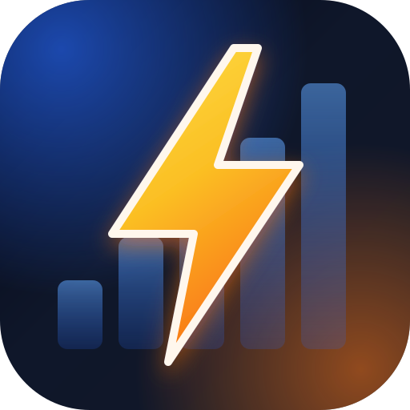

<p align="center">
  
</p>

<h1 align="center">Coin Master 活動道具能量換算器</h1>

<p align="center">
  把剩餘的活動道具換算成能量，加總後預估你下一週會被分到哪一組。<br>
  支援 繁體中文 / English / Tiếng Việt
</p>

## 功能

- **道具換算**：輸入各項活動道具的剩餘數量，自動依比例換算成能量
- **總能量計算**：基本能量 + 額外能量 + 道具換算能量
- **分組預估**：依總能量比對分組區間，標示下一週預估分組
- **分組對照表**：列出所有分組區間與內容，目前所在組別會被標亮
- **多語系**：右上角切換繁中、英文、越南文
- **手機友善**：手機版以精簡的兩格結果顯示，可「加入主畫面」當成 App 使用

## 換算比例

| 道具 | 比例（道具 : 能量） |
| --- | --- |
| 銅鑰匙 | 1 : 100 |
| 金鑰匙 | 1 : 250 |
| 藍色藥水 | 2000 : 1 |
| 紅色藥水 | 50000 : 1 |
| 炸彈 | 1 : 50 |
| 砲台 | 1 : 100 |
| 小徑餅乾 | 1 : 5 |
| 洞穴鑰匙 | 1 : 10 |
| 財富寶鎚 | 1 : 10 |
| 合併閃電 | 1 : 10 |
| 宇宙代幣 | 1 : 10 |
| 鏟子 | 1 : 10 |
| Boss 代幣 | 100 : 1 |
| 耕種花幣 | 100 : 1 |
| 雪崩代幣 | 20 : 1 |

## 分組區間

`0 - 900`、`901 - 4.9K`、`5K - 9.9K`、`10K - 19.9K`、`20K - 39.9K`、`40K - 74.9K`、`75K - 149K`、`150K - 299K`、`300K - 499K`、`500K - 999K`、`1M 以上`

## 使用方式

純靜態網頁，不需要安裝或建置：

1. 直接用瀏覽器開啟 `index.html`，或部署到 GitHub Pages
2. 填入基本能量與額外能量
3. 輸入剩餘的活動道具數量，右側即時顯示總能量與預估分組

### 加入主畫面

- **iPhone（Safari）**：分享 → 加入主畫面
- **Android（Chrome）**：選單 → 加到主畫面 / 安裝應用程式

## 專案結構

```
├── index.html             # 主頁面（HTML / CSS / JS 都在這裡）
├── manifest.webmanifest   # PWA 設定（名稱、圖示、主題色）
└── images/
    ├── icon.svg           # App 圖示（向量原檔）
    ├── icon-192.png       # Android / PWA 圖示
    ├── icon-512.png       # Android / PWA 圖示
    ├── apple-touch-icon.png  # iOS 主畫面圖示
    └── *.png              # 各道具圖示
```

## 修改比例或分組

- 換算比例：搜尋 `index.html` 中的道具欄位提示（如 `1:100`）及對應的計算邏輯
- 分組區間：修改 `index.html` 中的分組陣列（`rangeLabel` / `min` / `max`）

> 本工具為玩家自製的非官方輔助工具，與 Coin Master 及 Moon Active 無關，換算結果僅供參考。
